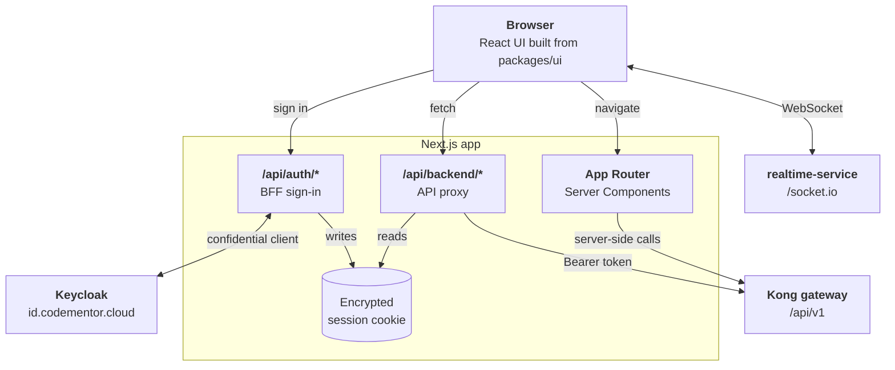
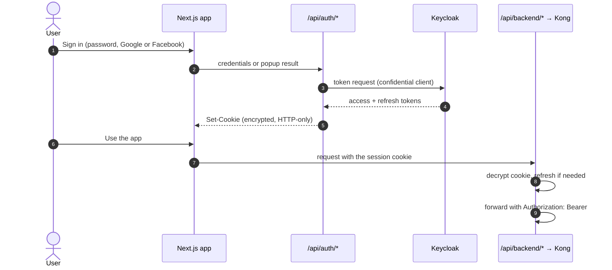

<div align="center">

<picture>
  <source media="(prefers-color-scheme: dark)" srcset=".github/assets/logo-dark.png">
  
</picture>

<h1>CodeMentor Frontend</h1>

<p>
  <strong>The three web applications of CodeMentor</strong> — the learner app, the lecturer studio and
  the admin console — in one pnpm + Turborepo monorepo.
</p>

<p>
  
  
  
  
  <br>
  
  
  
  
</p>

<p>
  <a href="https://codementor.cloud"><strong>Client</strong></a> ·
  <a href="https://lecturer.codementor.cloud"><strong>Lecturer</strong></a> ·
  <a href="https://admin.codementor.cloud"><strong>Admin</strong></a> ·
  <a href="#getting-started">Getting started</a> ·
  <a href="#contributing">Contributing</a>
</p>

</div>

---

## Table of contents

1. [About](#about)
2. [Applications](#applications)
3. [Architecture](#architecture)
4. [Tech stack](#tech-stack)
5. [Getting started](#getting-started)
6. [Configuration](#configuration)
7. [Quality checks](#quality-checks)
8. [Project structure](#project-structure)
9. [Design system](#design-system)
10. [Authentication](#authentication)
11. [Deployment](#deployment)
12. [Documentation](#documentation)
13. [Contributing](#contributing)
14. [Related repositories](#related-repositories)

## About

CodeMentor is a programming-learning platform: learners follow courses and learning paths, solve
auto-graded coding exercises, study in groups and get help from AI assistants; lecturers publish
content and earn revenue from paid courses; administrators moderate and run the platform.

This repository holds the three user-facing web applications. Each one deploys on its own, and all
of them reach the backend through **one origin** — the Kong gateway at `/api/v1` — and sign users
in through Keycloak at `https://id.codementor.cloud`.

## Applications

| | Client | Lecturer | Admin |
| --- | --- | --- | --- |
| **Package** | `@codementor/client` | `@codementor/lecturer` | `@codementor/admin` |
| **Production** | [codementor.cloud](https://codementor.cloud) | [lecturer.codementor.cloud](https://lecturer.codementor.cloud) | [admin.codementor.cloud](https://admin.codementor.cloud) |
| **Local** | http://localhost:3000 | http://localhost:3010 | http://localhost:3011 |
| **Audience** | Learners | Lecturers | Administrators |

<details open>
<summary><strong>Client — the learner app</strong></summary>

| Area | Routes | What learners do |
| --- | --- | --- |
| Discover | `/explore`, `/search`, `/roadmaps`, `/courses`, `/articles` | Browse learning paths, courses and articles; search and filter |
| Learn | `/roadmaps/[id]/…/learn/[lessonId]`, `/courses/[id]/lessons/[lessonId]` | Study video, theory and exercise lessons; progress unlocks the next ones |
| Practise | `/practice`, `/solve/[exerciseId]` | Solve coding exercises in a three-pane editor, run tests, submit, get hints from **Codey** |
| Study groups | `/workspace`, `/workspace/[groupId]` | Join with an invite code, share documents, do assignments, chat, ask the **Tutor** about group documents |
| AI | `/ai-tutor` | Talk to the AI assistant |
| Account | `/dashboard`, `/profile`, `/settings`, `/saved`, `/purchases` | Track progress, streaks and XP; manage the profile, reminders and purchases |

</details>

<details>
<summary><strong>Lecturer — the authoring studio</strong></summary>

| Area | Routes | What lecturers do |
| --- | --- | --- |
| Content studio | `/courses`, `/roadmaps`, `/exercises`, `/articles` (each with `/[id]/studio`) | Build courses, learning paths, exercises and articles; submit them for review |
| Exercises | `/exercises/[id]/studio`, `/exercises/[id]/solve` | Write statements, test cases and reference solutions; preview the learner's solve screen |
| AI | `/lecter` | Work with **Lecter**, the authoring assistant that reads the content library and runs code |
| Documents | `/documents` | Manage teaching documents |
| Business | `/earnings`, `/promotions` | Track revenue, request payouts, run course promotions |

</details>

<details>
<summary><strong>Admin — the operations console</strong></summary>

| Area | Routes | What administrators do |
| --- | --- | --- |
| Users | `/users` | Manage accounts, roles and status with confirmed, reasoned changes |
| Moderation | `/moderation`, `/reports`, `/workspaces` | Review content, resolve reports (with timed author suspension and rollback), inspect study groups read-only |
| Content | `/courses`, `/learning-paths`, `/exercises`, `/posts` | Oversee published content |
| Commerce | `/commerce`, `/revenue`, `/promotions` | Orders, refunds, payouts, reconciliation, revenue reports |
| Operations | `/dashboard`, `/system-activity`, `/audit-logs`, `/ai-operations`, `/code-judge`, `/settings` | Platform metrics, audit trail, AI usage, judge status |

</details>

## Architecture



**Boundaries**

- The three apps are **independent**: an app never imports code from another app.
- Shared code lives in `packages/*`; packages never depend on apps.
- Business code is organised **feature-first** under `apps/<app>/src/features`; App Router files
  stay thin and only compose.
- Frontend role checks improve the experience only — the backend enforces every permission.

The full rules: [`docs/architecture/frontend-architecture.md`](docs/architecture/frontend-architecture.md).

## Tech stack

| Concern | Technology |
| --- | --- |
| Framework | Next.js 16 (App Router, Server Components) · React 19 |
| Language | TypeScript 5, strict |
| Styling | Tailwind CSS 4 with design tokens · light and dark themes |
| Editors | Monaco (code) · TipTap (rich text) |
| Monorepo | pnpm 11 workspaces · Turborepo |
| Authentication | Keycloak OIDC through a backend-for-frontend; encrypted HTTP-only session cookies (JWE) |
| Realtime | Socket.IO client to `realtime-service` |
| Quality | ESLint (including UI rules) · `tsc` · `node:assert` self-checks run with `tsx` |
| Hosting | Vercel — one project per application |

## Getting started

**Prerequisites:** Node.js ≥ 22 and pnpm 11 (pinned by `packageManager`; run `corepack enable`).
A running backend gateway, either local (`http://localhost:8000/api/v1`) or production.

```bash
# 1. Install
pnpm install

# 2. Configure each app you run
cp apps/client/.env.example apps/client/.env.local
cp apps/lecturer/.env.example apps/lecturer/.env.local
cp apps/admin/.env.example apps/admin/.env.local

# 3. Run
pnpm dev               # all three applications
pnpm dev:client        # or one of them
pnpm dev:lecturer
pnpm dev:admin
```

Ports 3001–3013 belong to backend services; the frontend uses 3000, 3010 and 3011.

## Configuration

| Variable | Used by | Purpose |
| --- | --- | --- |
| `NEXT_PUBLIC_API_BASE_URL` | all | Gateway URL used by the browser |
| `API_INTERNAL_URL` | all | Gateway URL used by server-side code |
| `NEXT_PUBLIC_KEYCLOAK_*` | all | Keycloak URL, realm and public client |
| `KEYCLOAK_*` | all | Server-side Keycloak settings and the confidential BFF client |
| `KEYCLOAK_BFF_CLIENT_SECRET` · `AUTH_SESSION_SECRET` | all | **Server-only** secrets for the BFF and the session cookie |
| `NEXT_PUBLIC_REALTIME_URL` | all | WebSocket origin |
| `NEXT_PUBLIC_CLIENT_URL` | lecturer, admin | Links into the client app, including the admin "open content" handoff |
| `NEXT_PUBLIC_LECTURER_APP_URL` · `NEXT_PUBLIC_ADMIN_APP_URL` | client | Where lecturers and administrators land after signing in |

> Only browser-safe values may use the `NEXT_PUBLIC_` prefix — they are inlined into the client
> bundle. Never give a secret that prefix.

## Quality checks

| Command | What it checks |
| --- | --- |
| `pnpm lint` | ESLint across the workspace, including the UI rules (tokens only, no hand-rolled primitives) |
| `pnpm typecheck` | `tsc` for every app and package |
| `pnpm test` | `node:assert` self-checks (`*.test.ts`) run with `tsx` |
| `pnpm build` | Production build of every app — **the gate that catches prerender failures** |

Read the **exit code** of `pnpm build`; piping it through `tail` hides a failure. On a machine with
little memory, `pnpm build --concurrency=1` avoids running three Next.js compilers at once.

## Project structure

```text
codementor-frontend/
├── apps/
│   ├── client/                Learner application        :3000
│   ├── lecturer/              Lecturer studio            :3010
│   └── admin/                 Admin console              :3011
│       └── src/
│           ├── app/           App Router — thin route files only
│           ├── features/      feature-first business code
│           ├── components/    app-level composition of packages/ui
│           └── lib/           app-specific helpers
├── packages/
│   ├── ui/                    the only home for UI primitives
│   ├── editor/                Monaco code editor and TipTap rich-text editor
│   ├── solve/                 the three-pane solve screen (client + lecturer preview)
│   ├── api-client/            shared HTTP transport
│   ├── auth/                  roles, session helpers, admin-to-client sign-in handoff
│   ├── types/                 cross-application contracts
│   ├── utils/                 framework-independent helpers
│   └── eslint-config/ · typescript-config/
├── docs/                      architecture, design rules and feature notes
└── scripts/                   test runner and maintenance scripts
```

A workspace package must be listed as `workspace:*` **and** added to the app's
`transpilePackages`, because packages ship raw TypeScript.

## Design system

`packages/ui` is the single source of UI primitives — buttons, cards, tables, filters, modals,
badges. Applications compose them in `src/components`.

- Every page follows **`Breadcrumb → PageHeader → StatStrip? → content`**.
- Back navigation comes from the breadcrumb and one route map, never a hand-written back link.
- Styles use **design tokens only** — no raw palette colours or arbitrary sizes — so light and dark
  themes stay correct.
- The result of an action is a toast; errors and empty states use shared components.

Reference: [`DESIGN-SYSTEM.md`](DESIGN-SYSTEM.md) (tokens and components) and
[`AGENTS.md`](AGENTS.md) (the authoritative package table and UI rules).

## Authentication



- The browser **never sees** an access or refresh token.
- The BFF client `codementor-web-bff` is shared by all three apps, so its secret must match in
  every deployment.
- An administrator can open reported content in the client already signed in, through a
  short-lived, encrypted **handoff** (`@codementor/auth/handoff`); signing out of that borrowed
  session does not sign the administrator out.
- A suspended account is signed out within a minute and sees the reason, the remaining time and the
  appeal address on the sign-in page.

## Deployment

Each application is a separate **Vercel** project that builds from `main`; a push to `main`
deploys all three.

| Project | Root directory | Domain |
| --- | --- | --- |
| Client | `apps/client` | codementor.cloud |
| Lecturer | `apps/lecturer` | lecturer.codementor.cloud |
| Admin | `apps/admin` | admin.codementor.cloud |

Set the variables from [Configuration](#configuration) in every project. `KEYCLOAK_BFF_CLIENT_SECRET`
must be identical across all three.

## Documentation

| Document | Covers |
| --- | --- |
| [`docs/architecture/frontend-architecture.md`](docs/architecture/frontend-architecture.md) | Ownership, dependency boundaries, authentication, feature placement |
| [`DESIGN-SYSTEM.md`](DESIGN-SYSTEM.md) | Tokens, typography, components |
| [`AGENTS.md`](AGENTS.md) | Package table and UI rules — authoritative when documents disagree |
| [`docs/UI_AUDIT_AND_PLAN.md`](docs/UI_AUDIT_AND_PLAN.md) | UI audit, rules and rebuild plan |
| [`docs/PAGE_GUIDELINES.md`](docs/PAGE_GUIDELINES.md) | Page shell and review checklist |
| [`docs/COMPONENT_SPECIFICATION.md`](docs/COMPONENT_SPECIFICATION.md) | Component props and open gaps |
| [`docs/PROJECT_DESIGN_PRINCIPLES.md`](docs/PROJECT_DESIGN_PRINCIPLES.md) | Why the rules are what they are |
| [`docs/DASHBOARD_IMPLEMENTATION.md`](docs/DASHBOARD_IMPLEMENTATION.md) | How the dashboards are built |
| [`docs/AI_CODE_HINT_PIPELINE.md`](docs/AI_CODE_HINT_PIPELINE.md) | The code-hint pipeline |
| [`docs/revenue-analytics-ui.md`](docs/revenue-analytics-ui.md) · [`docs/commerce-job-results-ui.md`](docs/commerce-job-results-ui.md) | Revenue reports and commerce job results |

## Contributing

1. **Branch** from `main`: `feat/<topic>`, `fix/<topic>`, `docs/<topic>`, `chore/<topic>`.
2. **Commit** with [Conventional Commits](https://www.conventionalcommits.org/) and the app as scope —
   for example `fix(client): logging out of a borrowed session keeps the admin signed in`.
3. **Check locally** before opening a pull request:

   ```bash
   pnpm lint && pnpm typecheck && pnpm test && pnpm build
   ```

4. **Open a pull request** and fill in the [template](.github/pull_request_template.md). Add
   before/after screenshots for any visible change, in light and dark themes.
5. Do not mix unrelated dependency upgrades into a feature pull request.

## Related repositories

| Repository | Contents |
| --- | --- |
| **codementor-backend** | NestJS and Python services behind the Kong gateway |
| **codementor-infra** | PostgreSQL schema and migrations, MongoDB schemas, Keycloak and the data host |
